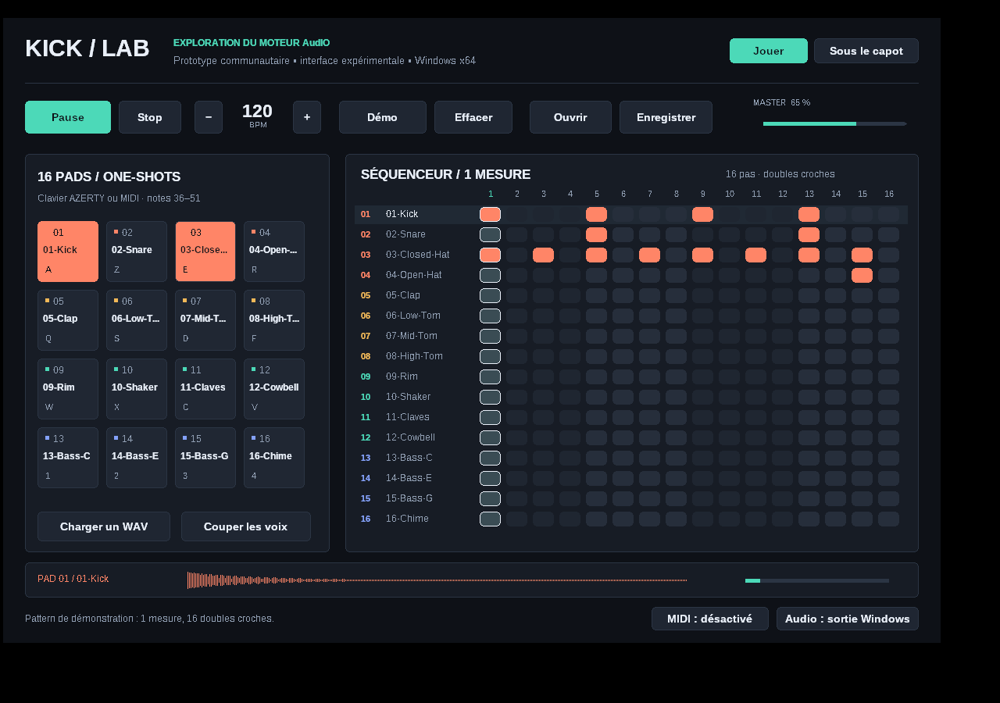

# KICK Lab 0.1 — prototype Windows avec AudIO

Prototype communautaire indépendant construit à partir du moteur AudIO publié dans MusicTribeOpenSource/0700-AAM. Ce projet fait entendre une partie réelle du code publié avec une interface de bureau nouvelle. Il ne reproduit pas l'interface JUCE KICK, son firmware complet ou ses programmes musicaux avancés.

## Télécharger la version Windows

[Dernière version et ZIP prêt à lancer](https://github.com/olivershadd-star/kicklab-windows/releases/latest). Télécharger `KickLab-Windows-x64.zip`, puis extraire tout le dossier. Les sources sont incluses dans le ZIP et dans ce dépôt.



## Démarrage

1. Extraire entièrement l'archive ZIP dans un dossier accessible en écriture.
2. Ouvrir KickLab.exe sous Windows 10/11 x64. Le dossier samples doit rester à côté.
3. Cliquer sur Jouer : le pattern de démonstration est déjà chargé.
4. Cliquer sur les pads ou jouer au clavier. Clic droit sur un pad : charger un WAV.
5. Choisir une sortie avec le bouton Audio si nécessaire. Un appareil exclusivement ASIO n'est pas directement pris en charge : choisir une sortie Windows exposée par son pilote.

Aucune installation, aucun Python et aucun JUCE requis pour lancer le binaire fourni.

## Utilisation

- 16 pads, un lecteur one-shot par pad. Un nouveau déclenchement du même pad relance son sample ; pas de polyphonie interne à un pad.
- Séquenceur de 16 pas sur une mesure, doubles croches ; cliquer dans la grille pour activer/désactiver un pas.
- Espace : lecture/pause ; Échap : arrêt et coupure des voix.
- Raccourcis des pads, rangée par rangée : A Z E R / Q S D F / W X C V / 1 2 3 4. Les lettres fonctionnent selon les touches logiques Windows ; la rangée numérique demande éventuellement Maj sur AZERTY. Le clic reste disponible.
- Tempo : boutons − et +, ou molette. Volume : cliquer sur la barre Master.
- MIDI : sélectionner une entrée ; notes 36 à 51, tous canaux, Note On à vélocité non nulle. Vélocité fixe pour le rendu ; Note Off, CC et horloge MIDI non gérés.
- WAV : PCM 16/24/32 bits ou flottant 32 bits, mono/stéréo, 8 à 192 kHz, jusqu'à 30 s et 32 Mo par fichier. Pas de WAV extensible, MP3, FLAC ou AIFF dans l'interface de ce prototype.
- Les WAV sont convertis à 48 kHz par interpolation linéaire au chargement. Cette conversion simple n'est pas destinée au mastering.
- Enregistrer/Ouvrir : fichiers .kicklab. Ils contiennent les pas, le tempo, le volume et les chemins absolus des WAV, sans incorporer les samples. Conserver les WAV à leur emplacement. Ce format n'est pas le format des projets de la machine KICK.
- Les projets ne sont chargés que si tous leurs samples sont disponibles ; un échec conserve le projet en cours.

## Ce qui est réutilisé

Le traitement suit : AudIO::Design → 16 AudIO::AudioPlayback → AudIO::Bus → buffers stéréo. Le décodeur AudioFile livré dans le dépôt est utilisé après validation et normalisation de l'en-tête WAV. Le reste de l'application (interface Win32, séquenceur simple, entrée MIDI, adaptation WinMM, sauvegarde) est nouveau.

Les sons fournis sont synthétisés spécialement pour le prototype avec tools/make_kit.py. Ce ne sont pas des samples d'usine Behringer et ils ne permettent pas de juger du son du futur produit.

## Limitations

Pas encore de VST3, d'ASIO, d'enregistrement audio, d'effets Airwindows, de moteur de synthèse KICK, de keygroups, d'édition avancée des samples ni d'interface KICK d'origine. La sortie est fixe : PCM stéréo 16 bits à 48 kHz via WinMM, quatre buffers de 256 trames. La latence réelle dépend du pilote Windows. Le déclenchement du séquenceur est quantifié au bloc (jusqu'à environ 5,33 ms), sans dérive cumulative du compteur.

Le gain de sortie et une saturation de sécurité sont appliqués après le mixage. Un chargement de projet peut provoquer une courte interruption audio. Une seule fenêtre/processus et une seule instance du moteur par processus sont utilisés ; les pools/queues globaux d'AudIO ne sont pas encore adaptés à un plugin multi-instance.

## Sources et compilation

Les sources complètes nécessaires à cette version sont dans source/. Le code du dépôt d'origine nécessaire au moteur est inclus dans source/vendor/AudIO, avec sa licence. La totalité du firmware original n'est pas recopiée dans cette archive.

Sur Windows, installer CMake et Visual Studio 2022 Build Tools avec le composant Développement Desktop en C++, puis exécuter source/BUILD-WINDOWS.bat. La voie MSVC est préparée mais n'a pas été exécutée dans l'environnement de test ; le binaire livré a été compilé avec MinGW-w64 GCC 12.2.

Avec MinGW-w64 installé et CMake :

```sh
cmake -S source -B build -G "MinGW Makefiles" -DCMAKE_BUILD_TYPE=Release
cmake --build build
ctest --test-dir build --output-on-failure
```

Depuis Linux, les tests du moteur peuvent aussi être construits avec cmake -S source -B build, cmake --build build et ctest --test-dir build --output-on-failure. Pour une compilation croisée Windows, passer CMAKE_SYSTEM_NAME=Windows et le compilateur x86_64-w64-mingw32-g++.

Les principaux fichiers à modifier sont source/src/engine.cpp pour le raccordement à AudIO et source/src/windows.cpp pour l'interface, le MIDI et la sortie audio. Les modifications du code d'origine sont listées dans source/vendor/AudIO/DESKTOP-CHANGES.patch.

## Vérifications réalisées

- Compilation Linux GCC 14.2 et Windows x64 MinGW-w64 GCC 12.2.
- Tests du moteur : silence initial, lecture WAV, mono en stéréo, fin de sample sans résidu, conversion 44,1 → 48 kHz, volume nul, mixage de 16 pads, séquenceur, pause, sauvegarde/rechargement et rejet de fichiers invalides.
- Même suite exécutée sur le binaire Windows sous Wine 8.
- Tests Linux avec AddressSanitizer et UndefinedBehaviorSanitizer : aucun diagnostic sur ces scénarios.
- Affichage et interactions de l'exécutable Windows sous Wine/Xvfb : pads/grille, onglets et sauvegarde/rechargement par les boîtes de dialogue.
- Sortie WinMM exécutée sous Wine avec un périphérique ALSA de capture de test : signal non silencieux capturé pendant la lecture.
- Pas de test sur une véritable installation Windows, sur une carte son physique ou avec un contrôleur MIDI physique. La validation sur le PC de l'utilisateur reste nécessaire.

DEMO.wav est un rendu hors ligne de huit secondes du kit et du pattern, calculé avec cette intégration AudIO.

## Origine et licences

Dépôt : https://github.com/MusicTribeOpenSource/0700-AAM
Archive analysée : 0700-AAM-main.zip.
Code Music Tribe et modifications de cette version : AGPL-3.0-or-later. Voir LICENSE et NOTICES.txt. AudioFile garde sa licence MIT dans son en-tête. Les noms Behringer et KICK restent des marques de leurs propriétaires ; ce prototype n'est pas un produit officiel Music Tribe.
