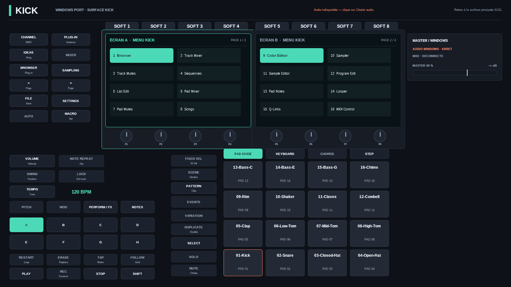

<div align="center">

# KICK LAB
### WINDOWS GROOVEBOX · OPEN-SOURCE ADAPTATION · MIDI CONTROLLER WORKFLOW


**ANKS LABS // BUILD. BREAK. REWIRE. LISTEN.**

[](https://github.com/olivershadd-star/Berhinger-Kick/releases/tag/v0.24.0-preview)
[](https://github.com/olivershadd-star/Berhinger-Kick)
[](https://github.com/olivershadd-star/Berhinger-Kick/releases)

</div>

---

> **Current status — public test build, NOT a stable release.** This project is under active experimentation. An alpha release is a future objective, not a published stable version; a VST3 port and broader validation are also planned.

## 01 // WHAT IS KICK LAB?

**KICK Lab** is an independent Windows adaptation of the open-source **KICK** code released by **Music Tribe / Behringer**. It explores how a groovebox initially conceived around a dedicated hardware surface can become a practical **standalone Windows application**, controlled by mouse and keyboard or by external MIDI controllers.

The project is **not** a commercial replacement for the original hardware, nor an official Behringer product. It is a hands-on development experiment: understand an existing codebase, keep useful musical workflows, adapt the engine and interface for a PC, and share the results for testing.

**Why this port?** Because musicians who already own capable MIDI equipment can experiment with a groovebox-like workflow without requiring another dedicated control surface. **Maschine+**, **Akai LPD8** and **MPK Mini** are particularly interesting in this context, each serving a different part of the workflow.

## 02 // SEE THE INTERFACE



*Capture de l'application Windows actuelle ; l'interface et les fonctions continuent d'évoluer.*

## 03 // DOWNLOAD & FIRST LAUNCH

### [⬇ Télécharger KICK Lab 0.24.0 preview — Windows x64 portable](https://github.com/olivershadd-star/Berhinger-Kick/releases/download/v0.24.0-preview/KickLab-Windows-x64-0.24.0-preview.zip)

**[Page de la release 0.24.0](https://github.com/olivershadd-star/Berhinger-Kick/releases/tag/v0.24.0-preview)** · **[Historique des releases](https://github.com/olivershadd-star/Berhinger-Kick/releases)**

**Configuration :** Windows 10/11 x64. Pas d'installateur : extraire entièrement le ZIP puis ouvrir `KickLab.exe`.

1. Extraire l'archive dans un dossier où KICK Lab peut écrire.
2. Garder `demo-kit` à côté de `KickLab.exe`.
3. Créer ou conserver un dossier `samples` à côté de l'exécutable.
4. Charger des WAV via Browser ou par clic droit sur un pad.
5. Choisir un pattern A–H et composer en modes Pad, Keyboard ou Step.
6. Utiliser File/Save pour sauvegarder un projet `.kicklab`, un kit `.kickkit` ou exporter un WAV.

La bibliothèque `samples` est **externe, personnelle et récursive**. Aucun sample commercial n'est inclus dans la distribution.

## 04 // WHAT CURRENTLY WORKS — 0.24.0 PREVIEW

| Domaine | Fonctionnalités présentes |
|:--|:--|
| **Pads & kits** | 16 pads, Programs et kits sauvegardables |
| **Patterns** | 8 patterns A–H indépendants, de 1 à 4 mesures |
| **Jeu & édition** | Pad, Keyboard, Chords, Step, REC quantifié, Events et List Edit |
| **Séquenceur** | Grille graphique 16 pistes × 16 pas, mesure d'édition fixe durant la lecture |
| **Édition** | Copy / Paste / Duplicate / Clear pour mesures, patterns, pads et kits |
| **Mixage** | Track Mixer et Pad Mixer, mute, solo, vumètres en dB |
| **Automation** | Level/Pan et paramètres d'effets par pattern et par step avec AUTO WRITE |
| **Traitements** | 4 inserts par pad, 31 effets Airwindows |
| **Export** | WAV stéréo 48 kHz / 24 bits du pattern actif |
| **MIDI** | Entrées simultanées Maschine+, LPD8 et MPK Mini ; profils réutilisables |
| **Interface** | Apparence personnalisable, fond d'écran importable |

Le moteur utilise **AudIO / Windows WinMM**. La sortie et l'export sont protégés à **−1 dBFS**. Le mixeur sépare le gain du pad, le niveau de piste, la somme pré-master, le niveau avant limiteur et la sortie finale.

## 05 // WHY MASCHINE+ / LPD8 / MPK MINI?

L'objectif n'est pas de recopier physiquement la surface KICK : il s'agit de retrouver **une logique de jeu tactile**, avec des pads pour déclencher et éditer, des commandes accessibles immédiatement et un routage MIDI adaptable.

| Contrôleur | Rôle dans KICK Lab |
|:--|:--|
| **Native Instruments Maschine+** | Surface principale pour pads, 16 Q-Links, boutons et deux pages de touches Soft |
| **Akai LPD8** | 8 pads pour sélectionner A–H ; 8 potentiomètres pour les macros M1–M8 |
| **Akai MPK Mini** | Jeu et enregistrement de la source mélodique avec REC quantifié |
| **Souris & clavier** | Utilisation complète sans contrôleur externe |

### Connexion MIDI

- Passer Maschine+ en **mode contrôleur** (`Shift + Channel/MIDI`) et sélectionner de préférence **Maschine Plus Virtual** dans KICK Lab.
- La page **MIDI Control** permet d'apprendre et sauvegarder les affectations Maschine+ dans `profiles/MaschinePlus.kickmidi`.
- Brancher **LPD8 et MPK Mini au PC** (directement ou via un hub relié au PC), et non pas comme des extensions USB virtuelles de Maschine+ : KICK Lab ouvre leurs entrées MIDI en parallèle.
- Les affectations LPD8 sont conservées dans `profiles/LPD8.kickmidi`.

La configuration dépend des ports MIDI détectés sur la machine et des modes de chaque contrôleur.

## 06 // ROADMAP

**Public preview ≠ version stable.** Les étapes suivantes constituent des objectifs de développement, pas des annonces de dates de sortie.

- [x] Portage Windows portable utilisable avec souris/clavier
- [x] Version publique de test 0.24.0
- [x] Contrôle simultané Maschine+ / LPD8 / MPK Mini documenté
- [ ] Affiner les mappings, le comportement en conditions réelles et les retours des testeurs
- [ ] Poursuivre les parties du portage encore incomplètes
- [ ] Étudier et valider un **port VST3** distinct du standalone
- [ ] Publier une version **alpha** après validation du périmètre retenu
- [ ] Envisager une phase **bêta** après les corrections et tests supplémentaires

## 07 // SOURCE TREE

| Emplacement | Rôle |
|:--|:--|
| [`experiments/kicklab/`](experiments/kicklab/) | Application Windows active et documentation |
| [`upstream/0700-AAM/`](upstream/0700-AAM/) | Sources originales de référence Music Tribe |
| [`port/`](port/) | Adaptateurs et recherches du port complet |
| [`docs/`](docs/) | Analyses et documentation |
| [`.github/workflows/`](.github/workflows/) | Compilation et tests Windows automatisés |

La branche `main` constitue la base publique du projet. Les fichiers de **GitHub Actions** sont des artefacts de test/validation ; pour obtenir une version destinée aux utilisateurs, passer par **Releases**.

## 08 // BUILD FROM SOURCE

Sur Windows avec Visual Studio 2022 et les outils CMake nécessaires :

```powershell
cmake -S . -B build -A x64
cmake --build build --config Release
ctest --test-dir build -C Release --output-on-failure
```

Sortie attendue : `build/incremental-port/Release/KickLab.exe`.

## 09 // LICENCE, ATTRIBUTION & DISCLAIMER

Ce portage communautaire indépendant repose sur des sources ouvertes publiées par **Music Tribe** et est distribué sous **AGPL-3.0-or-later**. Les composants tiers, notamment **Airwindows** et **AudioFile**, conservent leurs licences respectives. Consulter les fichiers de licence et les sources pour connaître les obligations de réutilisation et de redistribution.

**KICK, Behringer, Music Tribe, Maschine et Native Instruments** sont des marques de leurs propriétaires respectifs. ANKS Labs ne représente aucun de ces fabricants ; **ce projet n'est ni une version officielle ni un produit approuvé par eux.**

---

<div align="center">

**ANKS LABS // EXPERIMENTAL AUDIO DEVELOPMENT**

[](https://github.com/olivershadd-star)

</div>
