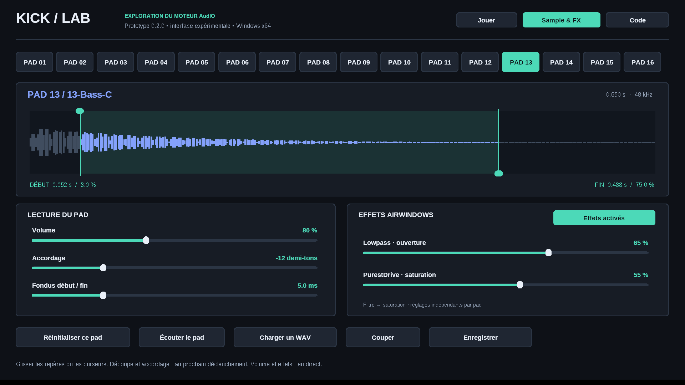

# KICK Lab 0.2.0 — sampler et effets Windows

Prototype communautaire indépendant utilisant le moteur **AudIO** et des effets **Airwindows** publiés dans [MusicTribeOpenSource/0700-AAM](https://github.com/MusicTribeOpenSource/0700-AAM).

**[Télécharger la dernière version Windows portable](https://github.com/olivershadd-star/Berhinger-Kick/releases/latest)**

Cette version ajoute un éditeur de sample et deux effets par pad. Ce n'est pas encore le firmware complet ni l'interface JUCE KICK d'origine.



## Pour essayer

1. Extraire entièrement le ZIP dans un dossier accessible en écriture.
2. Ouvrir **KickLab.exe**, en gardant le dossier **samples** à côté.
3. Dans **Jouer**, lancer le pattern ou cliquer sur les pads.
4. Dans **Sample & FX**, sélectionner un pad pour travailler son son.

Windows 10/11 x64, sans installation. Aucun compilateur, Python ou JUCE nécessaire pour lancer l'exécutable fourni. La fenêtre reste redimensionnable. Si aucun son ne sort, choisir une sortie Windows avec le bouton Audio de l'onglet Jouer.

## Sample & FX

- **Début / fin** : glisser les deux repères sur la forme d'onde. Le WAV original n'est pas modifié.
- **Volume** : réglage indépendant par pad, de 0 à 200 %, lissé pendant la lecture.
- **Accordage** : de −24 à +24 demi-tons. Il s'agit d'une transposition par vitesse de lecture : la durée change aussi, sans time-stretch.
- **Fondus** : de 0 à 20 ms au début et à la fin, limités à la moitié de la zone lue. Valeur initiale : 2 ms.
- **Lowpass / ouverture** : véritable effet Airwindows Lowpass, en pourcentage d'ouverture (pas une fréquence calibrée en Hz). À 100 %, le filtre est contourné.
- **PurestDrive / saturation** : véritable effet Airwindows PurestDrive, avec gain d'entrée jusqu'à ×4 et compensation en sortie dans l'adaptation. À 0 %, la saturation est contournée.
- **Bypass** : compare la lecture sans filtre/saturation, en conservant volume, accordage et découpe.
- **Réinitialiser ce pad** : remet les réglages à leur valeur initiale et conserve son sample.
- **Écouter le pad** : déclenche un one-shot. **Couper** arrête les voix.

La découpe, l'accordage et les fondus sont appliqués au prochain déclenchement. Le volume et les effets évoluent pendant la lecture, avec lissage. La chaîne est : lecteur AudIO étendu → Lowpass → PurestDrive → volume du pad → bus AudIO → volume général.

Charger un nouveau WAV sur un pad remet ses réglages à zéro. Cela coupe la voix de ce pad ; les autres pads continuent. Un nouveau déclenchement relance le sample : cette version n'a qu'une voix par pad.

## Séquenceur, clavier et MIDI

- 16 pads et 16 pas sur une mesure, doubles croches. Cliquer dans la grille pour activer/désactiver un pas.
- Espace : lecture/pause du séquenceur. Échap : arrêt et coupure des voix.
- Pads au clavier, par rangée : **A Z E R / Q S D F / W X C V / 1 2 3 4**. Le clic est toujours disponible.
- Tempo : boutons − / + ou molette. Volume général : barre Master.
- Clic droit sur un pad : charger un WAV. Glisser-déposer un WAV sur un pad ou sur l'éditeur est également possible.
- MIDI : sélectionner une entrée avec le bouton MIDI de Jouer ; notes 36 à 51, tous canaux. Vélocité fixe, Note Off, CC et horloge MIDI non gérés.

## WAV et projets

WAV PCM 16/24/32 bits ou flottant 32 bits, mono/stéréo, de 8 à 192 kHz, jusqu'à 30 secondes et 32 Mo par fichier. Les WAV sont convertis à 48 kHz au chargement par interpolation linéaire. WAV extensible, MP3, FLAC et AIFF ne sont pas pris en charge dans cette interface.

**Enregistrer / Ouvrir** sauvegarde le pattern, le tempo, le volume et les réglages de chaque pad dans un fichier `.kicklab`. Les samples restent référencés par leur chemin absolu et ne sont pas incorporés : conserver les WAV à leur emplacement. Un chargement échoué conserve le projet courant.

Les projets des versions 0.1.x sont lisibles. Les nouveaux projets utilisent **KICKLAB 2** pour conserver l'édition et les effets ; ils ne s'ouvrent pas dans les anciennes versions. Ce format est propre au prototype, pas à la machine KICK.

## Code réutilisé et adaptations

- **AudIO** : graphe `Design`, lecteur `AudioPlayback`, bus et mixage.
- **AudioFile** : décodeur WAV livré dans le dépôt, après validation et normalisation de l'en-tête.
- **Airwindows Lowpass / PurestDrive** : sources originales et adaptation `AudioEffectX` fournies dans 0700-AAM. Les deux effets sont construits avant le rendu et restent indépendants pour chaque pad.
- **Ajouts du prototype** : interface Win32, éditeur, extension du lecteur (découpe, interpolation pour la hauteur, fondus), séquenceur simple, MIDI, sortie WinMM, persistance et tests.

L'éditeur JUCE complet et les classes de voix KICK dépendent encore des couches manquantes. Cette version étend le lecteur AudIO qui fonctionne déjà sur Windows ; elle ne prétend pas porter l'éditeur ou le séquenceur KICK complet. Voir `source/vendor/AudIO/DESKTOP-CHANGES.patch`.

Le kit fourni a été synthétisé pour ce prototype. Aucun sample d'usine Behringer n'est inclus, et ces sons ne permettent pas de juger du son du futur produit.

## Stabilité audio et limites

Les corrections de 0.1.1 et 0.1.2 sont conservées : ordre des buffers, attente par événements du pilote, priorité MMCSS, séparation des copies graphiques et du rendu, interface redimensionnable.

Sortie fixe : PCM stéréo 16 bits à 48 kHz via WinMM, quatre buffers de 1 024 trames (environ 85 ms de réserve, plus le pilote). Pas d'ASIO ni de VST3 pour l'instant. Le séquenceur est quantifié au bloc de 256 trames (environ 5,33 ms), sans dérive cumulative du compteur. Le volume général et une saturation de sécurité protègent la sortie ; une accumulation de pads très forts peut néanmoins être écrêtée.

Pas encore de kits avec médias intégrés, de séquenceur KICK avancé, de keygroups, d'enregistrement, de synthétiseurs KICK ni de banque complète d'effets. Une seule instance du moteur est utilisée par processus ; les pools globaux d'AudIO ne sont pas encore adaptés à un plugin multi-instance.

## Développer

Les sources nécessaires sont incluses dans **source/**, avec les licences. Les fichiers principaux :

- `source/src/engine.cpp` : chargement, réglages et persistance.
- `source/src/pad_voice.hpp` : lecteur étendu et chaîne des deux effets.
- `source/src/editor_ui.inc` : commandes et dessin de l'éditeur.
- `source/src/windows.cpp` : fenêtre, pads, MIDI et sortie Windows.

Sur Windows : installer CMake et Visual Studio 2022 Build Tools avec Développement Desktop C++, puis lancer `source/BUILD-WINDOWS.bat`. La compilation MSVC et les tests sont également exécutés par GitHub Actions.

```sh
cmake -S source -B build -A x64
cmake --build build --config Release
ctest --test-dir build -C Release --output-on-failure
```

Avec MinGW-w64 : choisir le générateur `MinGW Makefiles` et `CMAKE_BUILD_TYPE=Release`. Pour tester le moteur sous Linux, omettre `-A x64` et utiliser `cmake --build build` puis `ctest --test-dir build --output-on-failure`.

Les vérifications audio couvrent la lecture WAV, les bornes de découpe, la durée et la fréquence à l'octave, les fades, les effets et le bypass, la persistance v2, les projets v1, la remise en file des buffers et la continuité sous activité graphique. Les tests automatisés ne remplacent pas un essai avec la carte son et le contrôleur MIDI de l'utilisateur.

## Licences

Code Music Tribe et modifications : **AGPL-3.0-or-later**. Airwindows et AudioFile conservent leur **licence MIT**. Voir LICENSE et NOTICES.txt. Les noms Behringer et KICK restent des marques de leurs propriétaires. Prototype indépendant, non officiel.
