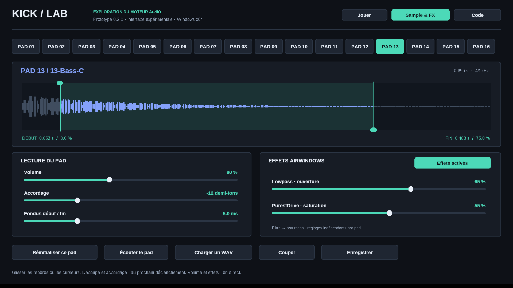

> **Base active du portage progressif.** Cette application conserve la sortie WinMM et le moteur AudIO déjà validés. Les modules KICK publiés y seront intégrés un par un, avec une commande souris pour toute fonction qui dépend normalement du matériel.

# KICK Lab — portage Windows en développement

Prototype communautaire indépendant utilisant le moteur **AudIO** et des effets **Airwindows** publiés dans [MusicTribeOpenSource/0700-AAM](https://github.com/MusicTribeOpenSource/0700-AAM).

Cette préversion conserve le moteur, la bibliothèque, les potentiomètres et le rack de quatre inserts validés. Elle ajoute une première tranche cohérente du flux musical KICK : Pad Perform/Keygroup mélodique, seize séquences de une à quatre mesures, Next Sequence et arrangement Song. La version 0.4.1 complète le MIDI Learn pour Maschine+ avec les seize pads, l'encodeur 4D absolu et une commande Retour/Escape.



## Pour essayer

1. Extraire entièrement le ZIP dans un dossier accessible en écriture.
2. Ouvrir **KickLab.exe**, en gardant le dossier **demo-kit** à côté. Le dossier **samples** de la bibliothèque est créé automatiquement.
3. Dans **Jouer**, cliquer sur les pads, ou charger **Démo** avant de lancer le pattern. Le pattern démarre volontairement vide.
4. Cliquer dans l'écran A ou B, puis sur **Sample & FX**, charge les quatre inserts du pad sélectionné dans cet écran. Choisir un slot, cliquer sur son effet ou son bypass, puis régler ses paramètres avec P1–P4 ou P5–P8. Les flèches `<` et `>` changent de page lorsqu'un effet possède plus de quatre paramètres.
5. Dans **Main**, l'élément **12 Program Edit** ouvre le volume, l'accordage, la découpe et l'enveloppe ADSR du pad. Les deux pages sont pilotées par P5–P8 dans l'écran B. L'éditeur détaillé transitoire reste accessible depuis **Sample Editor** dans le menu KICK.
6. Ouvrir **13 Pad Notes**, choisir le sample source et la note racine, puis passer la grille sur **NOTES**. Les pads et les lignes de la grille deviennent des hauteurs chromatiques, majeures ou mineures.
7. Ouvrir **4 Sequences** pour sélectionner ou mettre en attente une des seize séquences. Ouvrir **8 Songs**, choisir les séquences avec les pads, régler les répétitions avec P2 et les ajouter à l'arrangement.

Le kit chargé au démarrage se trouve dans `demo-kit`. La **Factory Sample Library** est le dossier `samples` créé à côté de l'exécutable ; elle commence sans son officiel.

Windows 10/11 x64, sans installation. Aucun compilateur, Python ou JUCE nécessaire pour lancer l'exécutable fourni. La fenêtre reste redimensionnable. Si aucun son ne sort, choisir une sortie Windows avec le bouton Audio de l'onglet Jouer.

## Sample & FX

La surface principale expose maintenant le slot d'effet sélectionné directement dans l'écran qui possède le focus. Les valeurs affichées viennent du véritable état du moteur : P1–P4 règlent l'écran A et P5–P8 l'écran B, par glissement vertical ou avec la molette. Un paramètre non disponible reste explicitement non assigné. Cliquer d'abord dans A ou B puis sur **Sample & FX** permet donc d'ouvrir deux slots différents, ou deux pages du même effet. Par exemple, TapeDelay2 peut afficher Time/Regen/Freq/Reso à gauche et Flutter/Dry-Wet à droite.

- **Début / fin** : glisser les deux repères sur la forme d'onde. Le WAV original n'est pas modifié.
- **Volume** : réglage indépendant par pad, de 0 à 200 %, lissé pendant la lecture.
- **Accordage** : de −24 à +24 demi-tons. Il s'agit d'une transposition par vitesse de lecture : la durée change aussi, sans time-stretch.
- **Fondus** : de 0 à 20 ms au début et à la fin, limités à la moitié de la zone lue. Valeur initiale : 2 ms.
- **Slots 1 à 4** : sélectionner un slot, puis choisir une catégorie et un effet. Les effets sont traités dans l'ordre 1 → 4.
- **Encodeur 4D** : dans Sample & FX, tourner sélectionne les slots 1 à 4, appuyer ouvre le choix d'effet et gauche/droite change la page de paramètres.
- **Filter** : Lowpass, Highpass et Isolator.
- **Saturation** : PurestDrive, Tube2 et Mojo.
- **Dynamics** : DrumSlam, ButterComp2 et SoftGate.
- **Ambience** : Chorus et StarChild.
- **Reverb** : Reverb.
- **Distortion** : Loud et Mackity.
- **EQ** : Baxandall2.
- **Modulation** : AutoPan et ChorusEnsemble.
- **Delay** : PurestEcho et TapeDelay2.
- **Lo-Fi** : DeRez2 et BitGlitter.
- **Filter, Dynamics et Reverb étendus** : Biquad2, Pressure5, Pop2, Chamber2 et Galactic complètent les effets précédents.
- **Paramètres** : chaque effet affiche ses noms et valeurs initiales d'origine. Les processeurs de cinq ou six paramètres utilisent deux pages indépendantes ; les flèches de l'écran ou gauche/droite au clavier changent de page.
- **Bypass du slot** : contourne uniquement l'effet sélectionné. **Bypass de la chaîne** contourne les quatre slots du pad.
- **Potentiomètres** : glisser verticalement pour un réglage continu. La molette agit sur le potentiomètre survolé ; ailleurs, elle continue de régler le tempo.
- **Réinitialiser ce pad** : remet les réglages à leur valeur initiale et conserve son sample.
- Cliquer directement sur un pad déclenche son one-shot. **Stop** arrête le transport et les voix.
- **Ajouter à la bibliothèque** : copie le WAV source du pad dans Kicks, Snares, Hats, Percussions, Basses, Pads, Leads, FX ou Autres, puis rattache le pad à cette copie en conservant ses réglages. Les effets ne sont pas rendus dans le WAV copié.

La page **Program Edit** 1/2 regroupe Volume, Accordage, Début et Fin. La page 2/2 regroupe Attack, Decay, Sustain et Release. Attack et Decay vont jusqu'à 2 secondes, Release jusqu'à 4 secondes, avec une courbe de réglage plus précise près de zéro. La touche relâchée ou le MIDI Note Off lance le Release ; les pas du séquenceur et les clics de pad restent des déclenchements one-shot.

La découpe, l'accordage, les fondus et l'enveloppe sont appliqués au prochain déclenchement. Le volume évolue pendant la lecture avec lissage. La chaîne est : lecteur AudIO étendu → ADSR → inserts 1 à 4 → volume du pad → bus AudIO → volume général.

Charger un nouveau WAV sur un pad remet ses réglages à zéro. Cela coupe la voix de ce pad ; les autres pads continuent. Un nouveau déclenchement relance le sample : cette version n'a qu'une voix par pad.

## Pad Perform, séquences et Song

- Chaque projet contient seize séquences de une à quatre mesures, en doubles croches. Les flèches `SEQ`, `BAR` et `LEN` au-dessus de la grille changent la séquence, la mesure visible et la longueur.
- Chaque séquence conserve simultanément ses pistes de batterie et une piste mélodique. **DRUM** affiche les seize pistes de samples ; **NOTES** affiche les hauteurs du sample source. **Démo** charge un rythme et une courte ligne de basse.
- **Pad Notes / Keygroup** reprend la logique Pad Perform publiée dans KICK : modes chromatique, gamme majeure et gamme mineure, sample source et note racine. Un clic de pad, une touche AZERTY ou une note MIDI joue le même sample à une hauteur différente. La transposition change aussi la durée, sans time-stretch.
- **Next Sequence** affecte les séquences 1–16 aux pads. À l'arrêt, le choix est immédiat ; pendant la lecture, la nouvelle séquence est mise en attente jusqu'à la fin complète de la séquence courante.
- **Song Editor** enchaîne jusqu'à 32 étapes, chacune composée d'une séquence et de 1 à 128 répétitions. `Lire` lance l'arrangement et s'arrête à sa fin.
- L'écran qui possède le focus détermine le rôle contextuel des pads : samples/notes, sélection de séquence ou sélection pour Song. Le clic droit d'un pad continue à charger un WAV.
- Espace : lecture/pause du séquenceur. Échap : arrêt et coupure des voix.
- Pads au clavier, par rangée : **A Z E R / Q S D F / W X C V / 1 2 3 4**. Le clic est toujours disponible.
- Tempo : boutons − / + ou molette. Volume général : barre Master.
- Clic droit sur un pad : charger un WAV. Glisser-déposer un WAV sur un pad ou sur l'éditeur est également possible.
- MIDI : sélectionner une entrée avec le bouton MIDI ou depuis la page **MIDI Control**. Les notes 36 à 51 restent le mapping initial ; chaque pad peut maintenant apprendre une autre note et un autre canal. Note Off et Note On de vélocité nulle libèrent l'enveloppe du pad.
- **MIDI Control** : ouvrir l'élément 16 du menu KICK. Les neuf pages regroupent P1–P8, les pads 1–16, Play/Pause–Stop–Shift–Enter, les quatre directions, le focus des écrans A/B, la rotation 4D et Retour/Escape. Cliquer sur une ligne affiche explicitement `EN ATTENTE` ; la prochaine note ou le prochain CC mémorise son numéro et son canal. Un clic droit efface un pad ou une commande. Les Q-Links et la rotation proposent `ABS`, relatif `1/127` et relatif `63/65` par clic droit.
- Un CC appris commande le même Q-Link que la souris dès que l'écran correspondant affiche une page d'inserts ou de **Program Edit**. Les commandes apprises passent par la même couche de surface que le clavier et la souris. Toutes les affectations sont automatiquement enregistrées dans `profiles/MaschinePlus.kickmidi`, à côté de l'exécutable, puis rechargées au démarrage. Les profils KICKMIDI 1 et 2 restent lisibles ; la rotation 4D des anciens profils Maschine+ est migrée vers le mode absolu.
- REC n'est volontairement pas exposé : le portage ne possède pas encore de véritable enregistreur KICK. La vélocité expressive, le retour LED et l'horloge MIDI ne sont pas encore gérés.

## WAV et projets

WAV PCM 16/24/32 bits ou flottant 32 bits, mono/stéréo, de 8 à 192 kHz, jusqu'à 30 secondes et 32 Mo par fichier. Les WAV sont convertis à 48 kHz au chargement par interpolation linéaire. WAV extensible, MP3, FLAC et AIFF ne sont pas pris en charge dans cette interface.

**Bibliothèque / WAV** propose trois chemins : parcourir la Factory Sample Library locale, importer un WAV depuis un autre emplacement du PC, ou ouvrir directement le dossier de la bibliothèque dans l'Explorateur. L'application crée les catégories au premier démarrage. Les samples d'usine Music Tribe ne font pas partie du dépôt public.

L'élément **Browser** du menu KICK ouvre maintenant la première page réellement portée du navigateur d'origine. Gauche/droite change de catégorie, haut/bas ou la rotation 4D parcourt les WAV, **Enter** ou **Charger** affecte le choix au pad et **Échap** revient au menu. La préécoute possède les modes `AUD OFF`, `AUD AUTO` et `AUD MAN` du Browser KICK ; elle utilise une voix AudIO séparée, joue le WAV une seule fois et ne remplace pas le sample du pad. Un chargement confirmé conserve le volume, l'accordage, la découpe, les fondus et les quatre inserts du pad. Le remplacement temporaire au sein du pattern, la recherche et les opérations de fichiers viendront dans une étape ultérieure.

**Enregistrer projet / Ouvrir projet** sauvegarde les seize séquences, leurs pistes rythmiques et mélodiques, les longueurs, les modes Pad Perform, l'arrangement Song, le tempo, le volume et les réglages de chaque pad dans un fichier `.kicklab`. Le nom du fichier enregistré ou chargé est confirmé dans la barre d'état. Les samples restent référencés par leur chemin absolu et ne sont pas incorporés : conserver les WAV à leur emplacement. Un chargement échoué conserve le projet courant.

Les projets **KICKLAB 1**, **KICKLAB 2**, **KICKLAB 3** et **KICKLAB 4** restent lisibles. Les nouveaux projets utilisent **KICKLAB 5** pour conserver les séquences, notes et Songs ; ils ne s'ouvrent pas dans les anciennes versions. Ce format est propre au prototype, pas à la machine KICK.

## Code réutilisé et adaptations

- **AudIO** : graphe `Design`, lecteur `AudioPlayback`, bus, mixage et modèle original `DawInserts` à quatre slots.
- **AudioFile** : décodeur WAV livré dans le dépôt, après validation et normalisation de l'en-tête.
- **Airwindows** : les vingt-six processeurs utilisent les sources originales et l'adaptation `AudioEffectX` fournies dans 0700-AAM. Chaque instance est créée par l'`ObjectFactory` d'AudIO dans le slot choisi.
- **Ajouts du prototype** : interface Win32, éditeur, extension du lecteur (découpe, interpolation pour la hauteur, fondus), projection Windows des pages Pad Perform/Next Sequence/Song, MIDI, sortie WinMM, persistance et tests.

L'éditeur JUCE complet et les classes de voix KICK dépendent encore des couches manquantes. Cette version étend le lecteur AudIO qui fonctionne déjà sur Windows ; elle ne prétend pas porter l'éditeur ou le séquenceur KICK complet. Voir `source/vendor/AudIO/DESKTOP-CHANGES.patch`.

Le kit fourni a été synthétisé pour ce prototype. Aucun sample d'usine Behringer n'est inclus, et ces sons ne permettent pas de juger du son du futur produit.

## Stabilité audio et limites

Les corrections de 0.1.1 et 0.1.2 sont conservées : ordre des buffers, attente par événements du pilote, priorité MMCSS, séparation des copies graphiques et du rendu, interface redimensionnable.

Sortie fixe : PCM stéréo 16 bits à 48 kHz via WinMM, quatre buffers de 1 024 trames (environ 85 ms de réserve, plus le pilote). Pas d'ASIO ni de VST3 pour l'instant. Le séquenceur est quantifié au bloc de 256 trames (environ 5,33 ms), sans dérive cumulative du compteur. Le volume général et une saturation de sécurité protègent la sortie ; une accumulation de pads très forts peut néanmoins être écrêtée.

Le premier Keygroup est monophonique : une seule voix existe par sample source, donc une nouvelle note remplace la précédente et les accords/progressions du Pad Perform KICK ne sont pas encore portés. Song enchaîne les séquences mais n'intègre pas encore les automations Track Mute ni un Track Mixer complet. Pas encore de kits avec médias intégrés, d'enregistrement, de synthétiseurs KICK ni de banque complète d'effets. L'enveloppe est commune au programme de sample actuel : les modes de lecture One Shot/Note On du firmware ne sont pas encore exposés séparément. Une seule instance du moteur est utilisée par processus ; les pools globaux d'AudIO ne sont pas encore adaptés à un plugin multi-instance.

## Développer

Les sources nécessaires sont incluses dans **source/**, avec les licences. Les fichiers principaux :

- `source/src/engine.cpp` : chargement, réglages et persistance.
- `source/src/pad_voice.hpp` : lecteur étendu et rack de quatre inserts.
- `source/src/editor_ui.inc` : commandes et dessin de l'éditeur.
- `source/src/windows.cpp` : fenêtre, pads, MIDI et sortie Windows.

Sur Windows : installer CMake et Visual Studio 2022 Build Tools avec Développement Desktop C++, puis lancer `source/BUILD-WINDOWS.bat`. La compilation MSVC et les tests sont également exécutés par GitHub Actions.

```sh
cmake -S source -B build -A x64
cmake --build build --config Release
ctest --test-dir build -C Release --output-on-failure
```

Avec MinGW-w64 : choisir le générateur `MinGW Makefiles` et `CMAKE_BUILD_TYPE=Release`. Pour tester le moteur sous Linux, omettre `-A x64` et utiliser `cmake --build build` puis `ctest --test-dir build --output-on-failure`.

Les vérifications audio couvrent la lecture WAV, les bornes de découpe, la hauteur Pad Perform, les fades, l'enveloppe ADSR et sa libération, les vingt-six effets, les quatre inserts, Next Sequence, les répétitions Song, la persistance v5, la migration des projets v1/v2/v3/v4, la remise en file des buffers et la continuité sous activité graphique. Les tests automatisés ne remplacent pas un essai avec la carte son et le contrôleur MIDI de l'utilisateur.

## Licences

Code Music Tribe et modifications : **AGPL-3.0-or-later**. Airwindows et AudioFile conservent leur **licence MIT**. Voir LICENSE et NOTICES.txt. Les noms Behringer et KICK restent des marques de leurs propriétaires. Prototype indépendant, non officiel.
