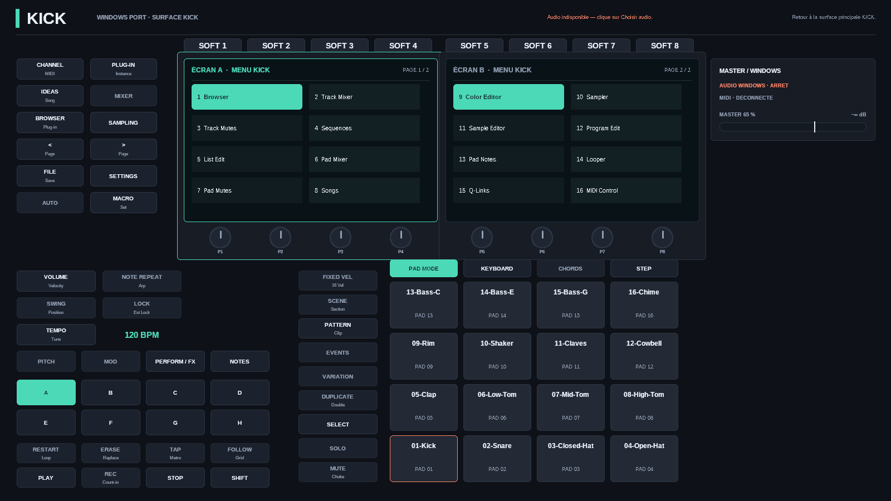
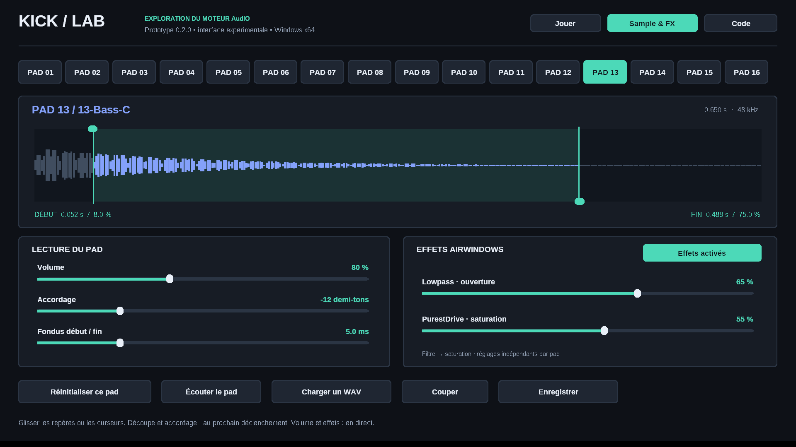

> **Base active du portage progressif.** Cette application conserve la sortie WinMM et le moteur AudIO déjà validés. Les modules KICK publiés y seront intégrés un par un, avec une commande souris pour toute fonction qui dépend normalement du matériel.

# KICK Lab — portage Windows en développement

Prototype communautaire indépendant utilisant le moteur **AudIO** et des effets **Airwindows** publiés dans [MusicTribeOpenSource/0700-AAM](https://github.com/MusicTribeOpenSource/0700-AAM).

La version 0.15.0 porte la première couche complète **Events** du séquenceur publié de KICK. Chaque step rythmique ou mélodique possède désormais sa vélocité, sa probabilité, son ratchet et sa longueur. Le bouton EVENTS ouvre l'éditeur contextuel ; les pads choisissent le step et P1–P4 règlent ses quatre propriétés. La version 0.14.0 avait complété le premier **Drum Program** fidèle au modèle publié de KICK : quatre couches par pad, sélection par vélocité/cycle/aléatoire, modes One Shot/Note On/Note Off, groupes Choke, lecture Reverse et dix-huit couleurs.





## Pour essayer

1. Extraire entièrement le ZIP dans un dossier accessible en écriture.
2. Ouvrir **KickLab.exe**, en gardant le dossier **demo-kit** à côté. Les dossiers externes **samples** et **kits/User** sont créés automatiquement.
3. Les boutons **A–H** sélectionnent huit patterns indépendants. Au premier lancement, chacun référence son Drum Program A–H ; A contient le kit de démonstration et B–H commencent vides. Un clic droit sur un pad charge un WAV dans le Program du pattern actif.
4. **PAD MODE** joue les seize samples. Le dernier pad joué devient automatiquement la piste lorsque l'on passe sur **STEP**. **KEYBOARD** répartit le sample sélectionné sur seize hauteurs. **CHORDS** produit des triades majeures ou mineures arpégées ; **NOTE REPEAT / Arp** active et coupe la répétition, et **FOLLOW / Grid** choisit 1/4, 1/8 ou 1/16. `Select + pad` ou `Shift + pad` choisit explicitement une piste Step.
5. **PLUG-IN / Instance** ouvre le **Program Manager** : seize Programs sur les deux écrans, assignables au pattern courant. **PERFORM / FX** affiche les inserts. Choisir un slot et régler ses paramètres avec P1–P4 ou P5–P8. Les flèches `<` et `>` changent de page.
6. **SAMPLING** ouvre l'éditeur détaillé. **PITCH / PAD EDIT** ouvre cinq pages : Sample, ADSR, Loop Sync, Drum et Layers. Sur Layers, P1 choisit L1–L4, P2/P3 règlent la plage de vélocité, P4 active Reverse ; un clic droit sur la barre d'écoute charge le WAV de cette couche. **BROWSER** parcourt toute l'arborescence du dossier `samples`.
7. Armer **REC**, lancer **PLAY**, puis jouer les pads. **FOLLOW / Grid** choisit la correction à l'enregistrement : 1/4, 1/8 ou 1/16. **4 Sequences** sélectionne une séquence ; **8 Songs** construit l'arrangement.
8. **MIXER** ouvre huit pistes à la fois. Les deux pages physiques commandent respectivement les pistes 1–8 et 9–16. Haut/bas choisit Level ou Pan ; **SOLO** ou **MUTE**, puis un pad, applique l'état à cette piste. Shift + touche Soft arme la piste.

Le kit chargé au démarrage se trouve dans `demo-kit`. La **Factory Sample Library** est le dossier `samples` créé à côté de l'exécutable ; elle commence sans son officiel.

Windows 10/11 x64, sans installation. Aucun compilateur, Python ou JUCE n'est nécessaire pour lancer l'exécutable fourni. La fenêtre 16/9 reste redimensionnable. Si aucun son ne sort, choisir une sortie avec **SETTINGS → Sortie audio Windows**.

## Sample & FX

La surface principale expose maintenant le slot d'effet sélectionné directement dans l'écran qui possède le focus. Les valeurs affichées viennent du véritable état du moteur : P1–P4 règlent l'écran A et P5–P8 l'écran B, par glissement vertical ou avec la molette. Un paramètre non disponible reste explicitement non assigné. Cliquer d'abord dans A ou B puis sur **Sample & FX** permet donc d'ouvrir deux slots différents, ou deux pages du même effet. Par exemple, TapeDelay2 peut afficher Time/Regen/Freq/Reso à gauche et Flutter/Dry-Wet à droite.

- **Début / fin** : glisser les deux repères sur la forme d'onde. Le WAV original n'est pas modifié.
- **Volume** : réglage indépendant par pad, de 0 à 200 %, lissé pendant la lecture.
- **Accordage** : de −24 à +24 demi-tons. Il s'agit d'une transposition par vitesse de lecture : la durée change aussi, sans time-stretch.
- **Fondus** : de 0 à 20 ms au début et à la fin, limités à la moitié de la zone lue. Valeur initiale : 2 ms.
- **Loop Sync** : la troisième page de Pad Edit active la synchronisation et règle le BPM source de 40 à 240. Les chemins ou noms contenant `loop` activent automatiquement Sync ; un nombre marqué `BPM` est repris, sinon le moteur déduit le nombre de mesures le plus plausible. Cette première synchronisation utilise la vitesse de lecture : elle suit exactement le tempo mais modifie aussi la hauteur, sans time-stretch spectral.
- **Slots 1 à 4** : sélectionner un slot, puis choisir une catégorie et un effet. Les effets sont traités dans l'ordre 1 → 4.
- **Encodeur 4D** : dans Sample & FX, tourner sélectionne les slots 1 à 4, appuyer ouvre le choix d'effet et gauche/droite change la page de paramètres.
- La rotation 4D de Maschine est absolue : droite augmente la valeur et avance dans les slots, gauche la diminue et recule. Dans FX, haut/bas choisit également le slot précédent/suivant, gauche/droite change la page et Enter ouvre le choix de l'effet. La sélection boucle entre les slots 1 et 4.
- **Filter** : Lowpass, Highpass et Isolator.
- **Saturation** : PurestDrive, Tube2 et Mojo.
- **Dynamics** : DrumSlam, ButterComp2 et SoftGate.
- **Ambience** : Chorus et StarChild.
- **Reverb** : Reverb.
- **Distortion** : Loud et Mackity.
- **EQ** : Baxandall2.
- **Modulation** : AutoPan et ChorusEnsemble.
- **Delay** : PurestEcho et TapeDelay2.
- **Lo-Fi** : DeRez2 et BitGlitter.
- **Filter, Dynamics et Reverb étendus** : Biquad2, Pressure5, Pop2, Chamber2 et Galactic complètent les effets précédents.
- **Paramètres** : chaque effet affiche ses noms et valeurs initiales d'origine. Les processeurs de cinq ou six paramètres utilisent deux pages indépendantes ; les flèches de l'écran ou gauche/droite au clavier changent de page.
- **Bypass du slot** : contourne uniquement l'effet sélectionné. **Bypass de la chaîne** contourne les quatre slots du pad.
- **Potentiomètres** : glisser verticalement pour un réglage continu. La molette agit sur le potentiomètre survolé ; ailleurs, elle continue de régler le tempo.
- **Réinitialiser ce pad** : remet les réglages à leur valeur initiale et conserve son sample.
- Cliquer directement sur un pad déclenche son one-shot. **STOP** arrête le transport et les voix.
- **Ajouter à la bibliothèque** : ouvre la sauvegarde dans le dossier actuellement parcouru afin de choisir librement la catégorie ou le sous-dossier. Le pad est rattaché à cette copie en conservant ses réglages. Les effets ne sont pas rendus dans le WAV copié.

Les cinq pages **Pad Edit** regroupent Sample, ADSR, Loop Sync, comportement Drum et quatre Layers. La page Drum règle le type de lecture, la méthode de sélection des couches, le groupe Choke et la couleur. La page Layers choisit L1–L4, leurs limites de vélocité et Reverse. Elle est accessible par le menu 12 ou directement par **PITCH / PAD EDIT**.

La découpe, l'accordage, les fondus et l'enveloppe sont appliqués au prochain déclenchement. Le volume évolue pendant la lecture avec lissage. La chaîne est : lecteur AudIO étendu → ADSR → inserts 1 à 4 → volume du pad → bus AudIO → volume général.

Charger un nouveau WAV sur un pad remet ses réglages à zéro. Cela coupe la voix de ce pad ; les autres pads continuent. Un nouveau déclenchement relance le sample : cette version n'a qu'une voix par pad.

## Programs et patterns

- **PLUG-IN / Instance** ou le menu **Programs** ouvre seize slots de Programs répartis sur les deux écrans. L'encodeur, les flèches, la souris et Enter fonctionnent sans contrôleur obligatoire.
- **Assigner** relie le Program sélectionné au pattern courant. Plusieurs patterns peuvent donc partager exactement le même kit et les mêmes réglages de pads.
- **Nouveau** crée un Drum Program vide et l'assigne au pattern. **Dupliquer** copie les seize samples et réglages vers un nouveau Program. **Supprimer** refuse toute suppression si un pattern le référence encore.
- Copier un pattern avec **Duplicate**, puis A–H, copie seulement ses événements et réglages de séquence. Le Program déjà assigné à la destination est conservé ; c'est la distinction essentielle entre une variation de pattern et une copie de kit.
- **Charger/Sauver kit** agit sur le Program actif. KICKKIT 2 conserve les quatre couches et leur comportement ; le fichier reste un échange léger de références et réglages, jamais un pattern ni des WAV incorporés.
- Les projets KICKLAB 1–9 sont migrés à l'ouverture. Dans un ancien projet, chaque ancienne banque A–H devient un Program distinct et chaque pattern A–H garde le lien correspondant.

## Pad Perform, séquences et Song

- Chaque projet contient seize séquences de une à quatre mesures, en doubles croches. L'écran **Sequences** choisit la séquence, la mesure visible et la longueur.
- Chaque séquence conserve ses pistes de batterie et une piste mélodique. **PAD MODE** choisit une piste de sample, **KEYBOARD** travaille les hauteurs et **STEP** affiche les seize pas sur les pads.
- **REC** arme l'enregistrement. Une fois PLAY actif, chaque pad joué est écrit sur la séquence courante. FOLLOW / Grid alterne entre 1/4, 1/8 et 1/16 ; l'enregistrement rythmique et mélodique utilise exactement la même grille que Step. STOP coupe le transport et désarme REC.
- **EVENTS** ouvre les propriétés du step sélectionné. Les seize pads choisissent le step sans le supprimer ; gauche/droite ou la rotation 4D avancent et reculent. **P1 Velocity** règle 1–127, **P2 Probability** 0–100 %, **P3 Ratchet** ×1–×8 et **P4 Length** 1–16 steps. Enter bascule l'événement. Les valeurs s'appliquent aussi aux notes Keyboard, et REC capture la vélocité MIDI réelle.
- **NOTE REPEAT / Arp** répète le pad Drum tenu ou parcourt les notes MIDI maintenues en Keyboard. La répétition est calculée dans le moteur audio à 1/4, 1/8 ou 1/16 et ne dépend pas du rafraîchissement graphique. **CHORDS** construit une triade sur le pad choisi et la confie à ce même arpégiateur.
- **Pad Notes / Keygroup** reprend la logique Pad Perform publiée dans KICK : modes chromatique, gamme majeure et gamme mineure, sample source et note racine. Un clic de pad, une touche AZERTY ou une note MIDI joue le même sample à une hauteur différente. La transposition change aussi la durée, sans time-stretch.
- **Next Sequence** affecte les séquences 1–16 aux pads. À l'arrêt, le choix est immédiat ; pendant la lecture, la nouvelle séquence est mise en attente jusqu'à la fin complète de la séquence courante.
- **Song Editor** enchaîne jusqu'à 32 étapes, chacune composée d'une séquence et de 1 à 128 répétitions. `Lire` lance l'arrangement et s'arrête à sa fin.
- L'écran qui possède le focus détermine le rôle contextuel des pads : samples/notes, sélection de séquence ou sélection pour Song. Le clic droit d'un pad continue à charger un WAV.
- Espace : lecture/pause du séquenceur. Échap : arrêt et coupure des voix.
- Pads au clavier, par rangée : **A Z E R / Q S D F / W X C V / 1 2 3 4**. Le clic est toujours disponible.
- Tempo : boutons − / + ou molette. Volume général : barre Master.
- Clic droit sur un pad : charger un WAV. Glisser-déposer un WAV sur un pad ou sur l'éditeur est également possible.
- MIDI : sélectionner Maschine+ depuis **SETTINGS** ou **MIDI Control**. Les notes 36 à 51 restent le secours initial du groupe actif. Note Off et Note On de vélocité nulle libèrent l'enveloppe.
- **MIDI Control** apprend 16 CC de knobs, 128 pads A–H et désormais les seize messages Soft des deux pages Maschine+. La page de pads suit le groupe actif. Un clic droit efface une affectation ou change le mode d'un encodeur.
- Les boutons A–H du template Maschine changent les pages de notes à l'intérieur du contrôleur : ils ne sélectionnent donc pas automatiquement les banques KICK. En Pad Mode, les pages apprises déclenchent les mêmes seize pads sans changer de banque. En Keyboard, toutes les notes MIDI reçues conservent leur hauteur, ce qui permet d'utiliser ces pages comme registres/octaves. Les banques KICK A–H restent sélectionnables à la souris ou par huit autres commandes MIDI apprises.
- Dans le Mixer, la page physique 1 vise les pistes 1–8 et la page 2 les pistes 9–16 ; ailleurs, les Q-Links restent contextuels. Le profil `KICKMIDI 5` possède une copie portable dans `profiles/MaschinePlus.kickmidi` et relit les versions 1–4. La rotation 4D reste disponible en relatif `1/127`, `ABS` ou `63/65`.
- Chaque apprentissage sauvegarde immédiatement le profil. `SETTINGS → Sauvegarder le profil MIDI maintenant` force l'écriture ; `SETTINGS → Ouvrir le dossier portable` montre le fichier. Dans MIDI Control, les touches contextuelles `SAVE MIDI` et `DOSSIER` fournissent les mêmes commandes. AppData n'est qu'une sauvegarde secondaire.
- REC est actuellement un overdub monophonique pour Keyboard. La vélocité d'entrée est conservée ; la capture automatique de la durée Note Off, les accords polyphoniques, le mode Replace, le compte à rebours, le retour LED et l'horloge MIDI restent à porter.

## WAV et projets

WAV PCM 16/24/32 bits, flottant 32 bits et WAV Extensible PCM/flottant, mono/stéréo, de 8 à 192 kHz, jusqu'à 60 secondes et 64 Mo par fichier. Les WAV sont convertis à 48 kHz au chargement par interpolation linéaire. MP3, FLAC et AIFF ne sont pas pris en charge dans cette interface.

**Bibliothèque / WAV** propose trois chemins : parcourir la bibliothèque locale, importer un WAV depuis un autre emplacement du PC, ou ouvrir directement le dossier dans l'Explorateur. Seul le dossier racine `samples` est créé ; ses catégories, packs et sous-dossiers appartiennent à l'utilisateur. Les samples d'usine Music Tribe ne font pas partie du dépôt public.

L'élément **Browser** suit maintenant l'arborescence réelle. Haut/bas ou la rotation 4D parcourt les éléments, droite ou Enter ouvre un dossier, gauche remonte au parent et Enter charge un WAV. Les dossiers sont affichés avant les fichiers. La préécoute `AUD OFF/AUTO/MAN` ignore les dossiers, joue le WAV une fois et ne remplace pas le sample du pad.

**FILE → Enregistrer/Ouvrir** sauvegarde les seize Programs et leurs liens avec les seize patterns, les références de samples et réglages de pads, les pistes rythmiques et mélodiques, les longueurs, les modes Pad Perform, l'arrangement Song, le tempo et le volume dans un fichier `.kicklab`. Les samples restent référencés par leur chemin et ne sont pas incorporés : conserver les WAV à leur emplacement.

**FILE → Sauvegarder/Charger un kit de pads** utilise un fichier `.kickkit` indépendant du projet. Il contient seulement les références et réglages des seize pads du Program actif : découpe, volume, pitch, ADSR, Loop Sync et quatre inserts. Il ne contient ni WAV, ni pattern, ni tempo, ni Song. Les WAV placés sous `samples` sont référencés relativement afin que l'ensemble portable puisse être déplacé ; les WAV extérieurs gardent leur chemin absolu. Un kit invalide ou dont un WAV manque est refusé sans modifier le Program déjà chargé. Le dossier `kits/User` reste extérieur à l'exécutable et peut être rempli librement par l'utilisateur.

**FILE → Exporter le pattern actif en WAV** rend exactement une boucle du pattern sélectionné avec son Program, à son tempo et sa longueur de une à quatre mesures. L'export est stéréo PCM 24 bits à 48 kHz et passe par le véritable moteur : pitch, enveloppes, niveaux, panoramiques, mutes/solos, Master et quatre inserts par pad sont inclus. Le transport est arrêté à la fin de l'export.

Les projets **KICKLAB 1** à **KICKLAB 11** et les kits KICKKIT 1 restent lisibles. Les nouveaux projets utilisent **KICKLAB 12** pour conserver les Events et les nouveaux kits utilisent **KICKKIT 2** pour conserver les quatre couches et le comportement Drum. Ils ne s'ouvrent pas dans les anciennes versions. Ces formats appartiennent au portage Windows, pas à la machine KICK.

## Code réutilisé et adaptations

- **AudIO** : graphe `Design`, lecteur `AudioPlayback`, bus, mixage et modèle original `DawInserts` à quatre slots.
- **AudioFile** : décodeur WAV livré dans le dépôt, après validation et normalisation de l'en-tête.
- **Airwindows** : les trente et un processeurs utilisent les sources originales et l'adaptation `AudioEffectX` fournies dans 0700-AAM. Chaque instance est créée par l'`ObjectFactory` d'AudIO dans le slot choisi.
- **Ajouts du prototype** : interface Win32, éditeur, extension du lecteur (découpe, interpolation pour la hauteur, fondus), projection Windows des pages Pad Perform/Next Sequence/Song, MIDI, sortie WinMM, persistance et tests.

L'éditeur JUCE complet et les classes de voix KICK dépendent encore des couches manquantes. Cette version étend le lecteur AudIO qui fonctionne déjà sur Windows ; elle ne prétend pas porter l'éditeur ou le séquenceur KICK complet. Voir `source/vendor/AudIO/DESKTOP-CHANGES.patch`.

Le kit fourni a été synthétisé pour ce prototype. Aucun sample d'usine Behringer n'est inclus, et ces sons ne permettent pas de juger du son du futur produit.

## Stabilité audio et limites

Les corrections de 0.1.1 et 0.1.2 sont conservées : ordre des buffers, attente par événements du pilote, priorité MMCSS, séparation des copies graphiques et du rendu, interface redimensionnable.

Sortie fixe : PCM stéréo 16 bits à 48 kHz via WinMM, quatre buffers de 1 024 trames (environ 85 ms de réserve, plus le pilote). Pas d'ASIO ni de VST3 pour l'instant. Le séquenceur est quantifié au bloc de 256 trames (environ 5,33 ms), sans dérive cumulative du compteur. Le Master affiche `DSP`, la part de ce budget consommée, et `RETARDS`, le nombre de blocs ayant dépassé leur délai.

Le premier Keygroup et son enregistrement sont monophoniques : une nouvelle note remplace la précédente et les accords/progressions du Pad Perform KICK ne sont pas encore portés. Velocity, Probability, Ratchet et Length sont portés, mais les automations Track Mute et l'édition polyphonique avancée restent à faire. Les `.kickkit` ne contiennent volontairement aucun média ; pas encore de synthétiseurs KICK ni de banque complète d'effets.

## Développer

Les sources nécessaires sont incluses dans **source/**, avec les licences. Les fichiers principaux :

- `source/src/engine.cpp` : chargement, réglages et persistance.
- `source/src/pad_voice.hpp` : lecteur étendu et rack de quatre inserts.
- `source/src/editor_ui.inc` : commandes et dessin de l'éditeur.
- `source/src/windows.cpp` : fenêtre, pads, MIDI et sortie Windows.

Sur Windows : installer CMake et Visual Studio 2022 Build Tools avec Développement Desktop C++, puis lancer `source/BUILD-WINDOWS.bat`. La compilation MSVC et les tests sont également exécutés par GitHub Actions.

```sh
cmake -S source -B build -A x64
cmake --build build --config Release
ctest --test-dir build -C Release --output-on-failure
```

Avec MinGW-w64 : choisir le générateur `MinGW Makefiles` et `CMAKE_BUILD_TYPE=Release`. Pour tester le moteur sous Linux, omettre `-A x64` et utiliser `cmake --build build` puis `ctest --test-dir build --output-on-failure`.

Les vérifications audio couvrent la lecture WAV, Reverse, les quatre couches Velocity/Cycle, les trois modes de déclenchement, Choke, les couleurs, les Events Velocity/Probability/Ratchet/Length, la découpe, Pad Perform, ADSR, les trente et un effets, les quatre inserts, Next Sequence, Song, la séparation Program/Pattern, KICKLAB 12/KICKKIT 2 et leurs migrations, le mixage, la remise en file des buffers et la continuité sous activité graphique. Les tests automatisés ne remplacent pas un essai avec la carte son et le contrôleur MIDI de l'utilisateur.

## Licences

Code Music Tribe et modifications : **AGPL-3.0-or-later**. Airwindows et AudioFile conservent leur **licence MIT**. Voir LICENSE et NOTICES.txt. Les noms Behringer et KICK restent des marques de leurs propriétaires. Prototype indépendant, non officiel.
